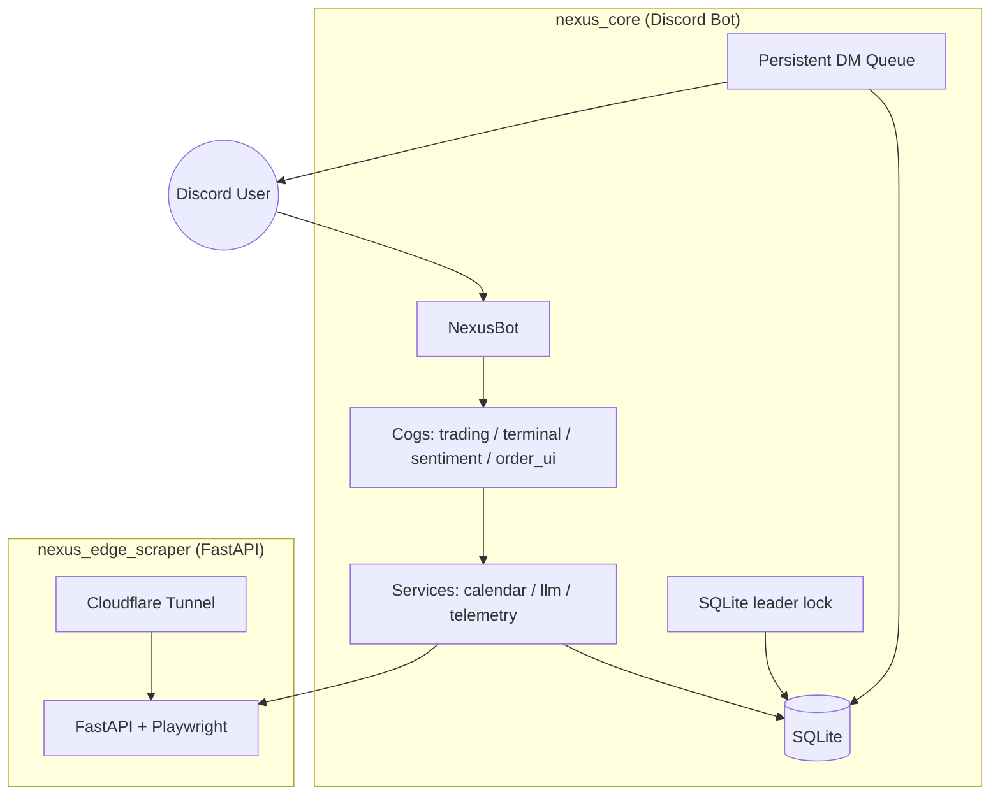

# 🌌 Nexus Seeker

[](https://www.python.org/)
[](nexus_core/docker-compose.yml)
[](LICENSE)

**給「Buy & Hold 加上期權」投資人的個人化風險顧問。**

Nexus Seeker 把做市商 GEX 結構、總經日曆、SEC 財報、輿情與預測市場等數據，接到**你自己的持倉、掛單與提領計畫**上，透過 Discord 主動告知你：哪個部位正在逼近結構失效、帳戶在壓力情境下還能支撐幾年提領、自選標的何時出現進場條件。

它**不替你下單、不承諾勝率**，也不取代你的選股判斷。

> 核心版本（nexus_core）：**v1.19.20**（請參考最新 Release）

---

## 🧭 定位

| Nexus Seeker 是 | Nexus Seeker 不是 |
|---|---|
| 以**你的部位**為中心的風險告知系統 | 全市場訊號推送服務 |
| 顧問：告知位階、風險與條件是否成立 | 自動交易或代操作引擎 |
| 數據整合層：把分散在多個網站的資訊收斂到一處 | 機構級數據供應商（見[數據來源與限制](https://github.com/star-netrunners/nexus-seeker#%EF%B8%8F-%E6%95%B8%E6%93%9A%E4%BE%86%E6%BA%90%E8%88%87%E9%99%90%E5%88%B6)） |
| 可逐欄稽核：推估值一律標註，閘門有前向紀錄 | 黑盒子模型或勝率保證 |

### 適合誰

- 長期持有個股／ETF 為主，自行完成基本面選股的投資人。
- 同時操作期權（買 Call、買 Put 避險、賣 Put、Covered Call），需要盯 Greeks、IV 與到期風險。
- 帳戶同時是生活費來源，需要知道「在最壞情境下還能提領幾年」。
- 習慣使用 Discord，偏好繁體中文介面。

### 設計原則

1. **左尾優先**：截斷下行的推播（保證金、結構失效、財報護城河破滅、提領跑道）不受任何預設情境關閉。
2. **不推你離開自己的策略**：多頭現貨一律以顧問語意呈現（告知目標區與結構失效位階），不發出「減碼換股」指令；停利分批類推播在「🧭 B&H 防守」情境預設關閉。
3. **誠實標註**：凡由啟發式規則或代理指標推算的欄位（例如 UOA 的 SWEEP/BLOCK/CROSS 分類），一律在欄位旁註明，不與一手市場數據混淆。
4. **以 Sortino、MDD 與 CVaR 評估，永遠附 Buy & Hold 對照組**：勝率不作為成效指標。

---

## 🧩 核心能力

### 🛡️ 左尾防護（預設開啟，預設情境無法關閉）

| 推播 | 內容 |
|---|---|
| 保證金與槓桿警戒 | 帳戶生存等級的強制平倉風險 |
| SEC 財報護城河破滅 | 每日 08:00 ET 掃描 10-K／10-Q／8-K，由 LLM 比對你登錄的投資假設；`/verify_thesis` 可手動觸發 |
| VIX 恐慌與期限結構倒掛 | 尾部風險事件；VIX 急升時提供 SPY 對沖股數與 Delta 再平衡建議 |
| 48 小時事件預警 | 自選與持倉標的財報、重要經濟數據 |
| 結構失效與保護性 Put | 以 Put Wall 與 15 分鐘 ATR 緩衝計算防洗盤停損位，15 分鐘實體 K 棒收盤確認跌破才告知 |
| 持倉負 Gamma 斷層 | 高 IV 崩跌風險 |
| 投組下行風險 | 距高點回撤階梯、CVaR 超出預算 |
| 提領跑道 | 以「2008 SPY × Beta」與「2000 QQQ × 股票占比」重演取較差者，壓力跑道跌破 3／2／1 年時警示，並在提領前提供賣出清單 |

### 🚀 進場與加碼顧問

- **多時間框架擠壓進場**：以 W／3D／D／65m／15m／5m 的 PowerSqueeze 狀態判斷自選標的進場與順勢加碼條件，推播參考進場價、停損與目標（規格見 [`docs/strategies/10_multi_timeframe_squeeze_entry.md`](docs/strategies/10_multi_timeframe_squeeze_entry.md)）。
- **B&H 目標區位階告知**：持倉抵達分層目標區時告知位置，不建議減碼。
- **進階策略模式**：`/settings` 可切換動態調整、左側、右側或做空的進場鐵律路由，供期權短線部位使用。

### 🔭 市場結構與情報

- **`/x` 標的分析中心**：報價、Session VWAP、15m ATR、GEX Net Regime、個股 Gamma Flip、Put／Call Wall 與距現價空間、Skew、UOA 權利金；支援多標的批次雷達與單一訊息翻頁。
- **`/market` 總經情報中心**：SPX、VIX 期限結構、US10Y、大盤 Gamma Flip、CME FedWatch、FRED 總經數據（含薩姆規則）、RRP 與 Fed 資產負債表。
- **`/calendar` 總經與財報日曆**：150 多項總經事件與 30 多位聯準會官員名稱中文化，14 日前瞻。
- **`/fa` 基本面雷達**：基本面事件、治理閘門與估值概覽。
- **輿情與預測市場**：Polymarket 成交量加權看多勝率（VWBP）與巨鯨異動、Reddit 熱門討論、權威新聞。
- **WTI 原油警報**：絕對價位與 30 分鐘波動雙軌觸發，標註能源關聯持倉。
- **個股價量突破警報**：自訂目標價與放量倍數，以 15 分鐘 K 棒收盤確認。

### 💼 持倉、掛單與期權工具

- **`/dash` 交易員看板**：現貨與期權混合持倉、未實現損益、提領跑道。
- **盤前／盤後報告**：盤前 09:00 ET 綜合報告；盤後 16:15 ET 結算，含 Brinson 歸因與板塊資金流向。
- **掛單遙測**：待成交掛單與現價的實時對齊及撤退線；`/stress_test` 計算 GTC 掛單成交後的現金赤字。
- **期權工具**：`/event_impact` Greeks What-if 模擬、`/cc_recovery` Covered Call 解套篩選、`/iv_rank`、`/skew_scan`、`/max_pain`。
- **虛擬交易室（VTR）**：紙上交易與對沖歸因，不涉及真實部位。

---

## 🔔 通知管理

`/notif_settings` 將 28 個推播頻道分為 6 個模組：

| 模組 | 用途 |
|---|---|
| 🛡️ 左尾防護 | 截斷下行；預設情境不會關閉 |
| 🚀 上行捕捉 | 進場與順勢加碼 |
| ✂️ 上行削減 | 停利分批、Covered Call、獲利鎖定、目標區告知 |
| 📡 盤中情報 | 個股 30 分鐘深度心跳、掛單遙測、期權掃描、價量突破 |
| 🌐 全天候情報 | Polymarket、WTI 原油 |
| 📋 定時報告與系統 | 盤前盤後報告、VTR 週報、機器人啟停 |

預設情境：**🧭 B&H 防守**（建議）、🎯 精準交易、🔕 盤中靜音、🛡️ 戰備全開。

---

## ⚠️ 數據來源與限制

Nexus Seeker 使用免費或低成本數據源，以下限制在使用前應先了解：

| 項目 | 來源 | 限制 |
|---|---|---|
| 報價與 K 線 | Finnhub、yfinance（核心端遭封鎖時改由 edge 服務代抓） | 非交易所直連；盤前盤後可能延遲 |
| 期權鏈、GEX、Put／Call Wall、Gamma Flip | yfinance 期權鏈自行計算 | OI 為每日更新，盤中牆位不反映當日新增部位；與 SpotGamma、MenthorQ 等專業模型可能有出入 |
| UOA 大單分類 | 期權鏈成交量與 OI 推估 | **啟發式推估**，非交易所逐筆成交流 |
| 總經 | CME FedWatch、FRED、財報日曆 | FRED 部分序列月更 |
| 財報 | SEC EDGAR（edge 服務擷取） | 假設比對依賴 LLM，結果僅供參考 |

**關於擇時效果**：專案內的回測（2007–2025 日線、2022–2025 多資產）顯示，本系統各種擇時與進出場規則**都未能穩定勝過**同等曝險的 Buy & Hold，降低回撤最可靠的方法仍是固定持股比例（詳見 [`docs/strategies/09_static_allocation_rebalance.md`](docs/strategies/09_static_allocation_rebalance.md)）。因此請把 Nexus Seeker 當作**風險告知與省時工具**，而非報酬來源。

若需要更高品質的 GEX 或逐筆期權流，Nexus Seeker 可與 SpotGamma、Unusual Whales 等商業服務互補使用。

---

## 🏗️ 系統架構

採雙服務架構，可部署於低記憶體 VPS：

- **`nexus_core/`**：主 Discord Bot。負責 slash commands、背景排程、風控引擎、持久化推播佇列與 SQLite 資料庫。多使用者掃描以標的層級去重，盤前 08:45 ET 預熱快取。
- **`nexus_edge_scraper/`**：邊緣爬蟲服務（FastAPI + Playwright）。隔離高耗能的網頁渲染與容易被封鎖的作業（Reddit、SEC 財報擷取、FedWatch），在核心端 yfinance 遭機房 IP 封鎖時代抓 K 線與期權鏈，並透過 Cloudflare Tunnel 提供給 Core 呼叫。



量化模型、策略規格與回測結論請見 [`docs/README.md`](docs/README.md)；開發規範請見 [`AGENTS.md`](AGENTS.md)。

---

## 📂 專案結構

```text
nexus-seeker/
├── nexus_core/              # 核心 Discord Bot 服務
│   ├── bot.py               # Bot 進入點與健康監控
│   ├── cogs/                # Discord 指令、背景排程與 UI 元件
│   ├── market_analysis/     # 量化引擎（掃描管線、提領跑道、總經訊號）
│   ├── services/            # 外部 API 封裝（日曆、LLM、Polymarket 等）
│   ├── database/            # SQLite Schema、遷移與通知頻道定義
│   ├── risk_engine/         # 風控路由與 NRO
│   ├── ui/                  # ANSI 格式化與表格渲染
│   └── tests/               # 單元與整合測試
├── nexus_edge_scraper/      # 邊緣爬蟲服務（Playwright）
│   ├── local_api.py         # FastAPI 路由
│   ├── section_extractor.py # SEC 財報區塊擷取
│   └── tests/               # 爬蟲端測試
├── scripts/                 # 輔助腳本與部署工具
├── docs/                    # 技術規格與策略文件
└── README.md
```

---

## 🚀 快速上手

專案以 Docker 部署，資料庫存於 Named Volume。

### 1. 必備條件
- Docker 與 Docker Compose
- Discord Bot Token
- Finnhub API Key
- Cloudflare Tunnel Token（邊緣爬蟲用）

### 2. 啟動 `nexus_edge_scraper`
```bash
git clone https://github.com/star-netrunners/nexus-seeker.git
cd nexus-seeker/nexus_edge_scraper

cp .env.example .env
# 編輯 .env 設定 CF_TUNNEL_TOKEN

docker compose up -d --build
```

### 3. 啟動 `nexus_core`
取得 `nexus_edge_scraper` 的公網 HTTPS URL 後填入 Core 的 `.env`：
```bash
cd ../nexus_core

cp .env.example .env
# 編輯 .env 填入 DISCORD_TOKEN、FINNHUB_API_KEY、TUNNEL_URL

docker compose up -d --build
```

### 4. 首次設定（建議順序）
1. `/settings`：設定資本、風險上限與提領參數。
2. `/add_holding`、`/add_trade`：登錄現貨與期權持倉。
3. `/add_watch`：加入自選標的（可一次加入多檔）。
4. `/notif_settings`：套用「🧭 B&H 防守」情境，再依需要微調。

---

## ⚙️ 環境變數

### `nexus_core/.env`
| 變數名稱 | 必填 | 說明 |
|---|---|---|
| `DISCORD_TOKEN` | ✅ | Discord 機器人 Token |
| `DISCORD_ADMIN_USER_ID` | ✅ | 管理員 Discord 帳號 ID（允許使用 admin 指令） |
| `FINNHUB_API_KEY` | 建議 | Finnhub 數據源 API Key |
| `TUNNEL_URL` | ✅ | Edge Scraper 的公開 API URL |
| `LLM_API_BASE` | 選用 | OpenAI 相容的 LLM API 網址 |
| `LLM_MODEL_NAME` | 選用 | LLM 模型名稱 |
| `API_KEY` | 選用 | LLM 驗證金鑰 |
| `LOG_LEVEL` | 選用 | 預設為 `WARNING`（`DEBUG`、`INFO`、`WARNING`、`ERROR`） |

### `nexus_edge_scraper/.env`
| 變數名稱 | 必填 | 說明 |
|---|---|---|
| `CF_TUNNEL_TOKEN` | ✅ | Cloudflare Tunnel token |

---

## 🔌 指令一覽

| 類別 | 指令 |
|---|---|
| 設定 | `/settings`、`/notif_settings`、`/wti_config` |
| 持倉 | `/add_holding`、`/edit_holding`、`/list_holdings`、`/remove_holding` |
| 期權部位 | `/add_trade`、`/edit_trade`、`/list_trades`、`/remove_trade`、`/settle_trade` |
| 自選標的 | `/add_watch`、`/remove_watch`、`/set_watch`、`/list_watch`、`/promote_watch` |
| 分析 | `/x`、`/market`、`/calendar`、`/fa`、`/quote`、`/verify_thesis` |
| 期權工具 | `/event_impact`、`/cc_recovery`、`/iv_rank`、`/iv_scan`、`/skew_scan`、`/max_pain`、`/ddp_scan` |
| 看板與掛單 | `/dash`、`/stress_test`、`/order_panel`、`/add_order`、`/edit_order`、`/remove_order`、`/list_orders`、`/telemetry_alert` |
| 警報 | `/price_alert_set`、`/price_alert_list`、`/price_alert_remove` |
| 對沖紀錄 | `/hedge_list`、`/settle_hedge`、`/rollover_history` |
| 輿情 | `/scan_news`、`/scan_reddit`、`/poly_list` |
| 虛擬交易室 | `/vtr_stats`、`/vtr_list` |
| 管理 | `/force_macro_update`、`/force_scan`、`/force_after_report`、`/sys_health` |

> 主機端另有 `cli.py` 開發者工具，供管理員手動觸發爬蟲或掃描。

---

## 🛠️ 開發與測試

本專案啟用 Mypy 嚴格模式，所有提交須通過型別檢查與測試。請在 Docker 環境中執行以確保依賴一致。

```bash
cd nexus_core

# 型別檢查
docker compose run --rm nexus-seeker python -m mypy --config-file pyproject.toml .

# 全部測試
docker compose run --rm nexus-seeker python -m pytest tests

# 單一測試檔
docker compose run --rm nexus-seeker python -m pytest tests/unit/test_edge_detection_sentiment.py
```

### 🌿 Git Worktree 多工作區（Bare Repo）

專案以 `.bare/` 集中託管 Git，多分支平行開發；`nexus-seeker.code-workspace` 可在 VS Code 統一載入。

```bash
./scripts/wt.sh list                              # 列出工作區
./scripts/wt.sh status                            # 各工作區 Dirty / Clean 狀態
./scripts/wt.sh st --check                        # 有未提交變更時退出碼為 1
./scripts/wt.sh add feat-new-feature origin/main  # 建立工作區（自動複製 .env）
./scripts/wt.sh remove feat-new-feature           # 移除工作區（保護 main）
```

- 遷移至 Bare Repo：`./scripts/migrate_to_bare.sh`（自動建立快照）。
- 回滾為單一工作區：`./scripts/rollback_bare.sh`。

---

## 📄 授權條款

本專案採用 [MIT License](LICENSE) 授權。本專案內容不構成投資建議，所有交易決策與風險由使用者自行承擔。
