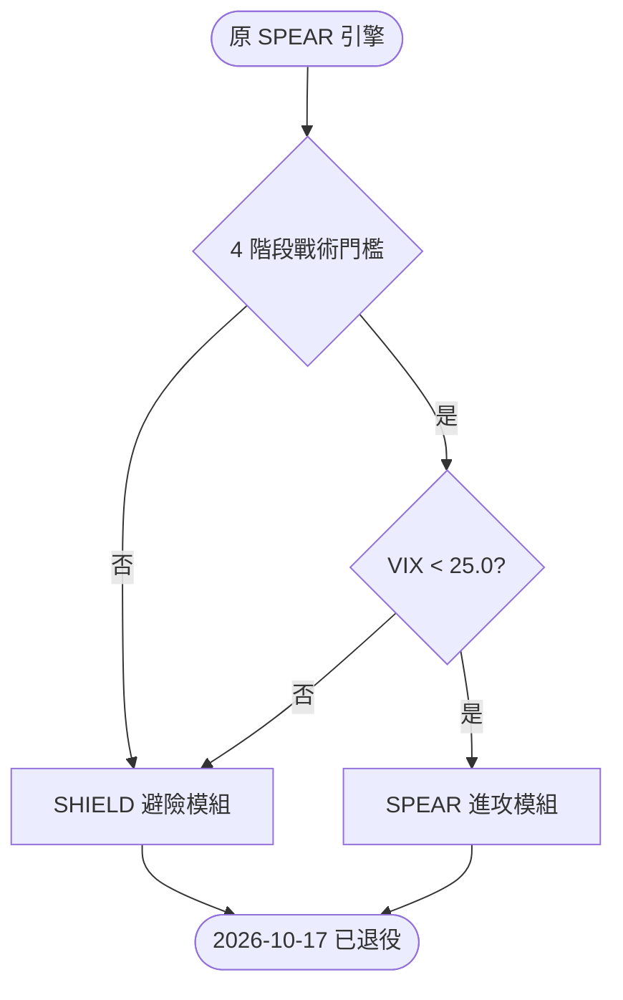

# Gamma Squeeze 引擎與 SPEAR 進攻訊號體系技術規格書（已退役）

> **已退役（2026-10-17）**：`NexusGammaSqueezeEngine` 與其 SPEAR 進攻訊號已整體移除，本文件僅保留為退役紀錄與歷史設計摘要，不再描述任何現行模組。檔名維持不變，以免外部連結與文件完整性檢查失效。
> 注意：`services/execution_router.py` 內 NRO 執行矩陣的「SPEAR／Module B」是另一套機制，不在本次退役範圍。

## 1. 核心哲學與適用市場環境

**退役原因（2026-10-17 稽查，使用者決策）**：

1. **物理前提與 SSOT 矛盾**：`01_gex_topology_and_walls.md` §1 與 `03_gamma_flip_estimation.md` §1 明訂 Gamma 擠壓發生於 Short Gamma（Net GEX ≤ 0／Spot < Flip，做市商追漲殺跌）；但 SPEAR 否決 Net GEX < 0，並以正 GEX 峰值為目標（Long Gamma：做市商逢漲賣出、均值回歸），本質是釘住磁吸的交易而非擠壓。
2. **長線進場已有專責規格**：多時間框架擠壓進場由 `../strategies/10_multi_timeframe_squeeze_entry.md` 負責；本專案以長抱為先，系統角色是擇時與部位管理，而 SPEAR 卻建議裸買價外 Call／多頭價差。
3. **實作缺陷**：IV Rank 未知時預設為 0.0 並被讀成「平靜低波動」環境；同一張 SPEAR 卡片一面叫使用者買價外 Call、一面又以 Vanna 對沖叫使用者賣出股票／SPY；Gate 1 只檢查 RVOL（無 K 棒方向、VWAP、多時間框架動能）；STO 上限只在剛好等於目標履約價時才比對；規格本身與程式碼已漂移（Gate 1／Gate 3／Kelly 分級）。
4. **觸發面極窄**：只對 `enable_analyst_agent = 1` 的使用者執行，而該旗標沒有 `/settings` 開關。

**取代方案**：

- 長線進場訊號：`../strategies/10_multi_timeframe_squeeze_entry.md`。
- 擠壓物理（Short Gamma、Flip 與牆體拓撲）：`01_gex_topology_and_walls.md` 至 `03_gamma_flip_estimation.md`。

**保留項目**：`enable_analyst_agent`（仍控制 `cogs/analyst_agent.py` 的 AI 評論）、`alpha_market_signals`（DDP 等警報頻道）、`/settle_hedge`、`services/execution_router.py`。

**已移除項目**（以下僅為純文字紀錄，檔案已不存在）：

- `nexus_core/market_analysis/gamma_squeeze_engine.py`（`NexusGammaSqueezeEngine`）
- `nexus_core/market_analysis/models/trader_models.py`（`TraderAccountState`／`OptionHolding`／`TickerMarketData`／`AdvancedTraderOutput`）
- `create_gamma_squeeze_alert_embed`（`alpha_market_signals` 上的 SPEAR 警報）
- `IntradayScanPipeline._run_loop` 內的 SPEAR 區塊（`enable_analyst_agent` 閘門、VIX 與投組 Greeks 抓取、`_dispatch_gamma_squeeze_alert`、`_fetch_ticker_market_data` 與其輔助函式）
- `gamma_squeeze_alert_` 去重鍵前綴

---

## 2. 數學模型與量化推導

以下為退役前設計的歷史摘要，不再生效。

以下為退役當下程式碼的實際行為。

**四階段門檻（退役時程式碼）**：

- Gate 1 流動性：市值 $\ge 20\text{B}$ 且 15 分鐘 RVOL $\ge 1.0$（Phase A 需 $\ge 1.5$）；僅在 RVOL 缺漏時才退回平均期權量 $\ge 50\text{k}$（Phase A 為 $65\text{k}$）。
- Gate 2 事件風險：距財報天數 $> 3$。
- Gate 3 資金效率：DTE $\ge 7$ 且 Vol/OI $\ge 0.8$ 的價外 Call 權利金 $\ge$ 基準 $1{,}000{,}000$ 美元，Phase A 門檻調高 $30\%$。
- Gate 4 跨市場驗證：`IVR` $\ge 50$ 或 $|\text{Skew}| \ge 0.05$。

**Kelly 倉位上限**：$5\%$（VIX $< 15$）、$3\%$（VIX 介於 15 至 25）、$0$（其餘）。

$$
\text{runway\_days} = \frac{\text{cash\_reserve} + \text{daily\_theta}}{\text{monthly\_burn\_rate} / 30}
$$

規格漂移：原規格文字（平均期權量、次日到期、Phase A 調降 $30\%$、Kelly 25／15／2.5%）早已與程式碼不符，這是退役原因 3 所指的規格漂移。

**Vanna 隱含對沖（歷史）**：以盤中波動率瞬時漂移 $d_\sigma = 0.10$ 估算 Hidden Delta，並據以產生對沖建議；此設計正是原因 3 中自相矛盾的來源。

---

## 3. 決策邏輯與狀態機 / 流程圖

退役前的流程如下，現已由 `IntradayScanPipeline` 移除，進場顧問分支直接進入迴圈休眠。

---

## 4. 關鍵具名常數與物理約束

下列常數隨引擎一併移除，僅供歷史對照。

| 常數名稱 | 數值 / 門檻 | 物理 / 代碼約束 | 狀態 |
| :--- | :--- | :--- | :--- |
| `base_gate_3_threshold` | `$1,000,000.0` | 明日到期 OTM Call 權利金基準門檻 | 已退役 |
| `Phase A Gate 3 Multiplier` | `1.30` | 開盤前小時 Gate 3 權利金門檻調高比例 | 已退役 |
| `max_fractional_kelly` | `0.05` | 分數凱利硬上限（VIX < 15 為 5%、15 至 25 為 3%） | 已退役 |
| `VIX Panic Line` | `25.0` | 強制切換 SHIELD 之 VIX 門檻 | 已退役 |
| `d_vol` | `0.10` | Vanna 對沖之波動率預期漂移量 | 已退役 |

---

## 5. 邊界條件、風控熔斷與例外處理

1. **不得復活舊路徑**：任何新的長線進場需求，一律走擠壓進場規格（`../strategies/10_multi_timeframe_squeeze_entry.md`），不得重建 SPEAR。
2. **`enable_analyst_agent` 語意縮減**：此旗標現僅控制 AI 評論，與 30 分鐘深度心跳的推播無關。
3. **去重鍵殘留**：`gamma_squeeze_alert_` 前綴已不再寫入，也已從 `purge_stale_kv_cache_dedup_keys()` 的前綴白名單移除。`kv_cache` 沒有 TTL，部署前留下的少數舊鍵不會被自動清除，成為無作用的殘列（已接受，可選擇一次性手動刪除）。

---

## 6. 核心程式碼檔案路徑關聯

退役後仍存在、與原 SPEAR 掛載點相關的檔案：

- `nexus_core/market_analysis/intraday_pipeline/pipeline.py`：`IntradayScanPipeline`（30 分鐘深度心跳，不再掛載 SPEAR）
- `nexus_core/market_analysis/squeeze_entry/evaluator.py`：多時間框架擠壓進場評估（取代方）
