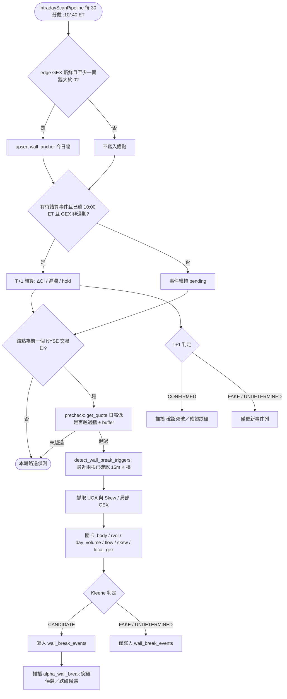

# GEX 牆突破／跌破判讀與 T+1 確認推播技術規格書（自選標的，未校準）

## 1. 核心哲學與適用市場環境

使用者提供的操作框架主張：價格穿越做市商 GEX 牆之後，只有在**做市商避險行為由均值回歸（逆勢對沖）轉為順勢追價**時，突破或跌破才具備延續性；否則只是流動性掃蕩（誘多／誘空）。框架以三道關卡檢驗這件事：

1. **15 分鐘價量**：實體 K 棒、相對量能、全日預估量。
2. **盤中期權流向、Skew 與牆位局部 GEX**：主力是在封頂／承接，還是在追價。
3. **T+1 OCC 結算**：隔日未平倉量變化（ΔOI）、牆位移徙與 GEX 遲滯 1.10。

本規格把框架轉成系統實際握有的資料所能執行的版本，並**如實揭露沒有實作的部分**（見 §5.4）。系統對外的命名刻意保守：盤中通過全部關卡稱為「突破候選／跌破候選」（待 T+1），T+1 通過稱為「確認突破／確認跌破」。所有門檻皆為 `PRE_CALIBRATION`（未校準），在 `wall_break_events` 前向蒐集足夠樣本、完成校準之前，不得把判讀結果視為已驗證的訊號。

### 1.1 為何被突破的是「前一交易日收盤牆」

edge 約每 30 分鐘重算一次 CallWall（只取履約價 $> \text{Spot}$）與 PutWall（只取履約價 $< \text{Spot}$）（`nexus_edge_scraper/gex_scraper.py`）。實測 MU 的 CallWall 在 2026-10-28 一天內於 970／980／1000 之間跳動：牆永遠位於現價之外，因此「收盤價高於**當前** CallWall」在定義上不可能發生。

因此被突破的牆必須是**固定下來的舊牆**：每次 30 分鐘掃描把 `(symbol, 今日)` 的牆 upsert 進 `wall_anchor`，隔日讀取 `trade_date < today` 的最新一列作為錨定牆（anchor wall）。只有當該列恰為**前一個 NYSE 交易日**（`market_time.get_last_completed_trading_date`）時才進行偵測；停機後或標的晚加入而過期多日的錨點不使用。

---

## 2. 數學模型與量化推導

### 2.1 穿越緩衝（Penetration Buffer）

以 15 分鐘真實 K 棒的 Wilder ATR(14) 為尺度；ATR 缺失時退回牆價百分比：
$$
\text{buffer} = \begin{cases} 0.5 \times \text{ATR}_{15m} & \text{ATR 可用} \\ 0.5\% \times w & \text{ATR 缺失} \end{cases}
$$
其中 $w$ 為錨定牆價位。

### 2.2 觸發條件

CallWall $w_c$ 與 PutWall $w_p$，$C_t$、$H_t$、$L_t$ 為已確認 15 分鐘 K 棒的收盤、最高、最低：

- `CLOSE_BEYOND`（BREAKOUT）：$C_t \ge w_c + \text{buffer}$；（BREAKDOWN）：$C_t \le w_p - \text{buffer}$。
- `WICK_REJECT`：$H_t \ge w_c + \text{buffer}$ 但 $C_t < w_c$（或 $L_t \le w_p - \text{buffer}$ 但 $C_t > w_p$），一律判為 FAKE（誘多／誘空）。
- 收盤落在緩衝帶內：不觸發。

### 2.3 相對量能與全日預估量

$$
\text{RVOL} = \frac{V_t}{\overline{V}_{\text{同時段}}} \ge 1.5
$$
同時段基準缺失時，退回前 20 根 K 棒均量。全日預估量以 390 分鐘常規時段的已過比例外推（比例下限 0.05）：
$$
\hat{V}_{\text{day}} = \frac{V_{\text{cum}}}{\max(\text{elapsed}/390,\ 0.05)} \ge 1.3 \times \text{SMA}_{20}(V_{\text{daily}})
$$

### 2.4 盤中判定（Kleene 三值邏輯）

各關卡取值 $\{\text{PASS}, \text{FAIL}, \text{UNKNOWN}\}$（✅❌❔），以三值邏輯組合（False 支配 AND、True 支配 OR；UNKNOWN 不會被當成通過或失敗）：

$$
\text{BREAKOUT} = \text{body} \wedge \text{rvol} \wedge \text{day\_volume} \wedge \text{flow} \wedge \text{skew} \wedge \text{local\_gex}
$$
$$
\text{BREAKDOWN} = \big( (\text{body} \wedge \text{rvol} \wedge \text{day\_volume}) \vee \text{local\_gex} \big) \wedge \text{flow} \wedge \text{skew}
$$

跌破方向的負 GEX 加速器可取代量能關卡，與來源框架的偽代碼一致。結果 True → CANDIDATE（突破候選／跌破候選，待 T+1）；False → FAKE；Unknown → UNDETERMINED。

### 2.5 各關卡判定

| 關卡 | BREAKOUT | BREAKDOWN |
|:---|:---|:---|
| `body` | 陽線實體 | 陰線實體 |
| `flow`（UOA） | 收盤上方有高信心 OTM `STO CALL` → FAIL（封頂）；否則有 `BTO CALL` → PASS；否則 UNKNOWN | 收盤下方有 OTM `STO PUT` → FAIL（承接）；否則有非 Whale_Hedge 的 `BTO PUT` → PASS；否則 UNKNOWN |
| `skew`（$\text{IV}_{\text{OTM Put}} - \text{IV}_{\text{OTM Call}}$ 的百分位 $p$） | $p \le 50$ PASS；$p > 80$ FAIL；其餘 UNKNOWN | $p > 80$ PASS；$p \le 50$ FAIL；其餘 UNKNOWN |
| `local_gex`（舊牆處淨 GEX） | $> 0$ PASS | $< 0$ PASS（助跌）；$\ge 0$ FAIL（正 GEX 托盤） |

價差的賣出腿（除非為收權利金結構）與跨式腿不計入 `flow`；已被穿越的價位亦排除。備援（過期）的 Skew 一律 UNKNOWN。

### 2.6 T+1 確認

$$
\Delta\text{OI} = \text{OI}_{T+1}(w,\ \text{exp}_T) - \text{OI}_{T}(w,\ \text{exp}_T) \le 0 \;\Rightarrow\; \text{PASS}
$$
其中 $w$ 為舊牆、$\text{exp}_T$ 為事件日 GEX 所用到期日，T+1 對同一到期日重讀；該到期日已過期則為 UNKNOWN。

GEX 遲滯（僅 BREAKOUT）：
$$
\text{GEX}(w_{\text{new}}) \ge 1.10 \times \max\big(\text{GEX}(w_{\text{old}}),\ 0\big) \quad \text{且} \quad \text{GEX}(w_{\text{new}}) > 0
$$
`hold`：T+1 現價仍位於舊牆之外。若兩日 GEX 到期日不同，遲滯判為 UNKNOWN（edge 的 GEX 只涵蓋最近到期日，週選換月會使牆機械式位移）。

最終判定：盤中 FAKE 維持 FAKE；其餘對各檢核取三值 AND：False → FAKE（翻假）、True → CONFIRMED、Unknown → UNDETERMINED。

---

## 3. 決策邏輯與狀態機 / 流程圖

### 3.1 推播政策（使用者決議 2026-10-29）

**只推播真正的突破／跌破**：盤中 CANDIDATE（突破候選／跌破候選），以及 T+1 CONFIRMED（確認突破／確認跌破，含盤中為 UNDETERMINED 者）。FAKE 與 UNDETERMINED 一律只分類與記錄（供日後校準），不推播。盤中候選訊息前綴為「（候選，待 T+1 確認；次日未收到確認推播即視為未成立）」。

### 3.2 使用者操作規則（來源框架，非系統驗證）

下列決策矩陣與劇本為**使用者提供的操作規則**，用語沿用來源框架；系統只實作其中的判定與（真實案例的）劇本指令推播，並未驗證其績效。

| 框架分類 | 條件摘要 | 系統對應 |
|:---|:---|:---|
| 真突破 | 收盤站上舊 CallWall 且量能、流向、Skew、局部 GEX 皆支持，T+1 ΔOI 與遲滯確認 | 盤中 CANDIDATE → T+1 CONFIRMED（內部紀錄碼 `TRUE_BREAKOUT`） |
| 假突破 | 影線刺穿後收回、或封頂流向／量能不足／Skew 不支持 | FAKE（記錄、不推播） |
| 真跌破 | 收盤跌破舊 PutWall 且量能或負 GEX 加速、承接缺席、Skew 偏空 | 盤中 CANDIDATE → T+1 CONFIRMED（內部紀錄碼 `TRUE_BREAKDOWN`） |
| 假跌破 | 影線下刺後收回、或正 GEX 托盤／承接出現 | FAKE（記錄、不推播） |

`TRUE_BREAKOUT`／`TRUE_BREAKDOWN` 是與來源框架對齊的內部紀錄碼，並非系統宣稱的已驗證結論。

劇本指令（§五）中，推播只包含真實案例，兩個方向各自的指令如下：

- **突破**：嚴禁追高現貨與在突破點賣低履約價 Covered Call；等待縮量回踩原 CallWall 確認支撐後，以 10%–15% 輕倉配置右側現貨，結構停損設於 $w \times (1 - 1.0\%)$ 至 $w \times (1 - 0.6\%)$（$w$ 為實際舊牆價位）；或於原底牆賣 30–45 DTE、Delta 0.12–0.15 的現金擔保賣 Put（CSP）。
- **跌破**：嚴禁左側接刀，嚴禁在負 GEX 助跌區賣任何 CSP；保持 100% 現金／BOXX，待恐慌出清、VIX $\ge 22$ 且下方出現新的正 GEX 承接底牆後才進入評估。此方向沒有停損區間。

框架對假突破／假跌破的處置指令（例如反向操作）列於此處僅供使用者參考，系統不推播。

---

## 4. 關鍵具名常數與物理約束

所有門檻皆為 `PRE_CALIBRATION`（尚未以前向資料校準），定義於 `nexus_core/market_analysis/wall_break.py`。

| 常數名稱 | 數值 / 門檻 | 物理 / 代碼約束 | 程式碼檔案路徑 |
| :--- | :--- | :--- | :--- |
| `PENETRATION_ATR_MULT` | `0.5` | 穿越緩衝 = 0.5 × ATR15m | `nexus_core/market_analysis/wall_break.py` |
| `PENETRATION_SPOT_PCT_FALLBACK` | `0.005` ($0.5\%$) | ATR 缺失時的牆價百分比緩衝 | `nexus_core/market_analysis/wall_break.py` |
| `RVOL_PASS_MIN` | `1.5` | 相對量能通過門檻 | `nexus_core/market_analysis/wall_break.py` |
| `DAY_VOLUME_SMA_MULT` | `1.3` | 全日預估量須達日線 SMA20 量的倍數 | `nexus_core/market_analysis/wall_break.py` |
| `SKEW_BULLISH_MAX_PCT` | `50.0` | 突破方向 Skew 百分位上限 | `nexus_core/market_analysis/wall_break.py` |
| `SKEW_BEARISH_MIN_PCT` | `80.0` | 跌破方向 Skew 百分位下限 | `nexus_core/market_analysis/wall_break.py` |
| `GEX_HYSTERESIS_RATIO` | `1.10` | T+1 新牆 GEX 對舊牆 GEX 的遲滯倍數 | `nexus_core/market_analysis/wall_break.py` |
| `RETEST_STOP_PCT_MIN` | `0.006` ($0.6\%$) | 劇本回測停損區間下緣 | `nexus_core/market_analysis/wall_break.py` |
| `RETEST_STOP_PCT_MAX` | `0.010` ($1.0\%$) | 劇本回測停損區間上緣 | `nexus_core/market_analysis/wall_break.py` |
| T+1 最早時間 | `10:00 ET` | 當日第一個不早於 10:00 且 GEX 非過期的 30 分鐘掃描 | `nexus_core/services/wall_break_service.py` |
| `wall_anchor` 保留期 | 14 日 | 03:00 ET 維護 `purge_stale_wall_break()` | `nexus_core/database/wall_break.py` |
| `wall_break_events` 保留期 | 180 日 | 同上 | `nexus_core/database/wall_break.py` |
| `WALL_BREAK_ALERT_ENABLED` | 預設 `true` | 環境變數；僅抑制推播 | `nexus_core/config.py` |
| 去重鍵前綴 | `wall_break_` | 已登記於每日去重清理白名單 | `nexus_core/database/cache.py` |

---

## 5. 邊界條件、風控熔斷與例外處理

### 5.1 錨點與時序

- **部署首日無錨點**：`wall_anchor` 尚無前一交易日資料，當日不偵測。
- **錨點只來自新鮮 GEX**：非 `_is_stale_cache`，且至少一面牆 $> 0$ 才 upsert。
- **錨點過期**：停機或標的晚加入造成錨點不是前一個 NYSE 交易日時，不使用。
- **T+1 不在 07:00**：07:00 時 edge 尚無 GEX 桶（第一筆在 09:30），Yahoo OI 亦不保證即時更新。管線首輪在 09:30 開盤後，此時 edge GEX 多半仍是前一日的，故訂為 10:00 ET 下限；更早的掃描讓事件維持 pending。
- **提早收盤日**：全日預估量以 390 分鐘常規時段外推，未針對提早收盤日調整，屬已知限制。

### 5.2 UOA 方向信心與到期日換月

- UOA 方向由最後成交價相對 NBBO 快照推斷，數分鐘內可能翻轉。低信心成交已標為 `MIDPOINT`，因此「沒有符合條件的 UOA」判為 UNKNOWN，而非失敗。
- 兩日 GEX 到期日不同時，遲滯判為 UNKNOWN；ΔOI 對事件日到期日重讀，已過期則為 UNKNOWN。
- **不做牆位移徙檢核**：edge 的 CallWall 只取現價上方、PutWall 只取現價下方，所以「新牆移到舊牆之外」只要 `hold` 通過就必然成立，屬恆真式，刻意省略。

### 5.3 推播、去重與熔斷

- 只有 CLOSE_BEYOND 事件在 T+1 結算；WICK_REJECT 事件直接終局為 FAKE，沒有 T+1 列。盤中為 FAKE 的 CLOSE_BEYOND 事件仍會結算並記錄。
- 只推播盤中 CANDIDATE 與 T+1 CONFIRMED；FAKE／UNDETERMINED 只記錄。
- 去重鍵：`wall_break_{uid}_{SYM}_{direction}_{trigger}_{YYYYMMDD}` 與 `wall_break_t1_{uid}_{SYM}_{direction}_{YYYYMMDD}`。
- `DispatchRecord` 的 signal_kind 為 `INFO`、scenario 為標籤（只有被推播的案例會進 `notify`，故為 `TRUE_BREAKOUT`／`TRUE_BREAKDOWN`，T+1 加後綴 `_T1`）、action 為 `WALL_BREAK_CLOSE_BEYOND`（盤中候選）或 `WALL_BREAK_T1_CLOSE_BEYOND`（T+1 確認）。WICK_REJECT、FAKE、UNDETERMINED 不會派發，因此沒有派發紀錄。
- 通知頻道 `alpha_wall_break`（📡 盤中情報、`INTEL`、`INTRADAY`、雜訊、預設開啟），標籤「🧱 GEX 牆突破／跌破確認推播 (自選標的，未校準)」，可於 `/notif_settings` 開關。遷移 `v097` 依使用者明確的 `alpha_price_volume_watch` 設定回填，已靜音盤中雜訊者不會被悄悄重新訂閱。
- 熔斷開關 `WALL_BREAK_ALERT_ENABLED`（預設 true）只抑制推播，錨點、事件與 T+1 仍照常記錄。

### 5.4 未實作項目（如實揭露）

1. **新牆 ΔOI ≫ 0**：事件當下新牆尚未產生，且系統不保留逐履約價的 OI 歷史。
2. **真正的 OCC 結算資料**：以 Yahoo OI 代替。
3. **Call-skew 的變化量**：僅有 Skew 水位百分位，沒有變化量。

此外，牆位移徙檢核因恆真而省略（見 §5.2）。「新牆 ΔOI」與「牆位移徙」兩項的缺口，使 T+1 確認弱於來源框架的完整版本。

### 5.5 校準狀態

所有門檻皆為 `PRE_CALIBRATION`。`wall_break_events` 是供日後校準的前向蒐集紀錄；在完成校準前，判讀結果不得作為已驗證的訊號，本文件亦不宣稱任何命中率。

---

## 6. 核心程式碼檔案路徑關聯

- `nexus_core/market_analysis/wall_break.py`
  - 純函式：觸發偵測 `detect_wall_break_triggers`、關卡評估、Kleene 判定、T+1 結算與全部 `PRE_CALIBRATION` 常數
- `nexus_core/services/wall_break_service.py`
  - `WallBreakMonitor`: 錨點 upsert、precheck、UOA 抓取、事件落庫、T+1 結算與推播編排（每個標的每輪只評估一次，結果送給所有追蹤者）
- `nexus_core/market_analysis/intraday_pipeline/pipeline.py`
  - `IntradayScanPipeline`: 對每個自選標的呼叫 `WallBreakMonitor`，獨立於心跳警報等級與進場顧問
- `nexus_core/database/wall_break.py`
  - `wall_anchor`／`wall_break_events` 存取層與 `purge_stale_wall_break()`
- `nexus_core/database/migrations/v097_add_wall_break_tables.py`
  - 建立 `wall_anchor`（PK symbol + trade_date）與 `wall_break_events`（UNIQUE symbol + trade_date + direction + trigger_kind，含 T+1 欄位），並回填 `alpha_wall_break`
- `nexus_core/cogs/embed_builders/wall_break_embeds.py`
  - 兩種被推播案例的 Embed（關卡表與劇本指令）
- `nexus_edge_scraper/gex_scraper.py`
  - 約每 30 分鐘重算 CallWall／PutWall 的來源
- `nexus_core/market_analysis/volume_profile.py`
  - 相鄰微觀結構規格（`05_volume_profile_and_dp_poc.md`）的籌碼分佈實作
